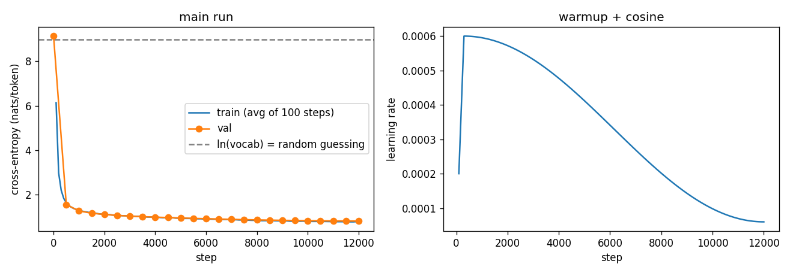
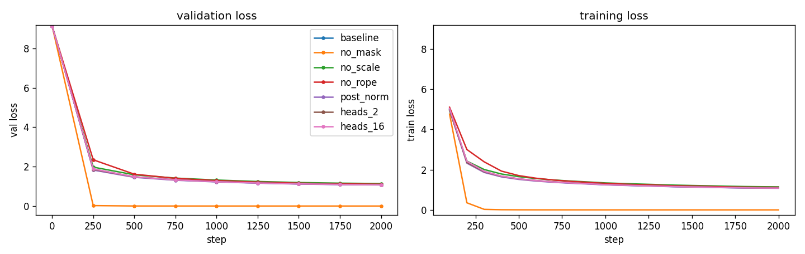

# hindi-tinystories-gpt

A 33M-parameter decoder-only Transformer written from scratch in PyTorch and trained on about 100M tokens of Hindi children's stories. Every component (causal multi-head attention, rotary position embeddings, RMSNorm, SwiGLU) is implemented by hand in [`model.py`](model.py); there are no calls to `nn.MultiheadAttention` or `F.scaled_dot_product_attention`.

## Results

| | |
|---|---|
| Validation loss | **0.814** nats/token (perplexity **2.26**) |
| Training loss | 0.784 |
| Loss at initialisation | 9.136 (ln 8000 = 8.987) |
| Tokens seen | 197M (12,000 steps) |
| Throughput | 33k tokens/s on one L4, bf16 |
| Training time | 98 min |



Sample stories, prompted with "एक बार की बात है" ("Once upon a time"), are in [`results/samples.md`](results/samples.md).

Temperature 0.7, top-k 40:

> एक बार की बात है, एक छोटे से गाँव में एक प्यारा सा बच्चा था जिसका नाम था मोहन। मोहन को खेलना बहुत पसंद था। एक दिन, उसने अपने दोस्तों के साथ खेलते-खेलते एक सुंदर बगीचे में जाने का सोचा। बगीचे में बहुत सारे रंग-बिरंगे फूल थे और एक बड़ा सा पेड़ था। मोहन ने सोचा, "यहाँ खेलना बहुत मजेदार होगा!" जब मोहन और उसके दोस्त बगीचे में पहुँचे, तो उन्होंने देखा कि वहाँ एक पुराना बक्सा पड़ा है। बक्सा बहुत भारी था और सभी बच्चे उसे खोलने की कोशिश करने लगे। मोहन ने कहा, "चलो, इसे खोलते हैं!" सभी बच्चे उत्सुकता से बक्से के चारों ओर इकट्ठा हो गए। जब उन्होंने बक्सा खोला, तो वहाँ एक चमकदार गेंद थी। गेंद को देखकर सभी 

## Model

| | |
|---|---|
| Architecture | decoder-only, pre-norm, 8 blocks |
| Width | d_model 512, 8 heads (d_head 64), SwiGLU d_ff 1344 (≈ 8/3 · d_model) |
| Position | rotary embeddings (RoPE, θ = 10,000) on queries and keys |
| Normalisation | RMSNorm before each sublayer and before the output head |
| Context | 512 tokens |
| Parameters | 33,104,384 |

Where the parameters are (d = 512, V = 8000, d_ff = 1344, L = 8):

| Part | Formula | Count |
|---|---|---|
| Token embedding | V · d | 4,096,000 |
| Attention, per block | 4 · d² (W_q, W_k, W_v, W_o) | 1,048,576 |
| SwiGLU, per block | 3 · d · d_ff (W1, W3, W2) | 2,064,384 |
| RMSNorm gains, per block | 2 · d | 1,024 |
| 8 blocks | 8 × 3,113,984 | 24,911,872 |
| Final RMSNorm | d | 512 |
| Output head (untied) | d · V | 4,096,000 |
| **Total** | | **33,104,384** |

Each block computes

```
x = x + Attention(RMSNorm(x))      # causal, RoPE inside
x = x + SwiGLU(RMSNorm(x))
```

and the loss is next-token cross-entropy: the logits at position t are scored against the token at t + 1.

## Ablations

Each run trains a fresh model for 2,000 steps with one thing changed.

| Run | Change | Val loss | Train loss |
|---|---|---|---|
| `baseline` | the model as trained | 1.078 | 1.082 |
| `no_mask` | causal mask removed (validation re-scored with the mask on) | 0.001 (mask on: 12.260) | 0.000 |
| `no_scale` | no 1/√d_head scaling of attention scores | 1.141 | 1.146 |
| `no_rope` | RoPE removed: no position signal | 1.107 | 1.116 |
| `post_norm` | post-norm blocks instead of pre-norm | 1.072 | 1.077 |
| `heads_2` | 2 heads of 256 dims | 1.085 | 1.089 |
| `heads_16` | 16 heads of 32 dims | 1.078 | 1.084 |



## Data and tokenizer

- **Data:** the first 400k stories of [TinyStories-Regional/hindi-generated_4o-mini_2M](https://huggingface.co/datasets/TinyStories-Regional/hindi-generated_4o-mini_2M) (Apache-2.0). The last 2,000 stories are held out for validation.
- **Tokenizer:** SentencePiece BPE with an 8,000-token vocabulary and byte fallback, trained on 20k stories. That gives about 4 Devanagari characters per token.

## Training

AdamW (β = 0.9, 0.95; weight decay 0.1 on matrices only), peak learning rate 6e-4 with 300 warmup steps and cosine decay to 6e-5, gradient clipping at 1.0, bf16 autocast. 12,000 steps × 32 sequences × 512 tokens ≈ 197M tokens (about 1.9 epochs), on a single NVIDIA L4 in Google Colab.

To reproduce, open [`train_gpt.ipynb`](train_gpt.ipynb) in Colab with an L4 runtime and run the cells in order. It streams the data, trains the tokenizer, trains the model and checkpoints to Google Drive, so it can resume after a disconnect.

## Limitations

- **Synthetic, narrow data.** The stories were written by GPT-4o-mini, so the style is repetitive (many begin "एक बार की बात है, एक छोटे से गाँव में…"), and the model reproduces that style. The low perplexity reflects how predictable this data is; it is not comparable with models trained on natural Hindi text.
- **Small model.** It learns spelling, grammar and story structure, but not consistent plots over long passages.
- **Simple attention kernel.** Attention materialises the full T × T score matrix, without FlashAttention or a KV cache. That keeps the code readable but costs speed. Training ran at about 34k tokens/s.
- **fp16 is not supported.** The causal mask fills with −1e9, which overflows fp16, so the code needs bf16 or fp32.

## Files

| File | |
|---|---|
| `model.py` | the model: attention with RoPE, RMSNorm, SwiGLU, block, GPT, sampling |
| `train_gpt.ipynb` | data, tokenizer, training loop, evaluation and sampling (Colab) |
| `results/` | loss curve, ablation plot, final metrics, generated samples |
| `logs/train_log.txt` | the full training log as printed: loss, learning rate, gradient norm, throughput, validation loss and samples |
| `logs/history.json` | every logged point: train loss and learning rate every 100 steps, validation loss every 500 |
| `logs/run_config.json` | model and training config, GPU, PyTorch version, wall-clock time, tokens/s |
| `logs/experiments/` | the ablation runs: printed log and per-run loss history |
